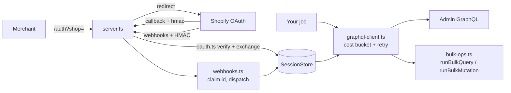

# shopify-admin-app

A TypeScript skeleton for the parts of an embedded Shopify app that agencies keep rewriting and getting subtly wrong: **OAuth install, session storage, a cost-aware Admin GraphQL client, bulk operations with idempotent mutations, and webhook handlers (app/uninstalled and the GDPR trio).**

It has zero runtime dependencies (Node 20+ `fetch`, `http`, `crypto`) and runs end to end against a bundled mock Shopify server, so you can see it work without an account.

## What it handles

| Failure | What a first draft does | What this repo does |
|---|---|---|
| Forged OAuth callback | Trusts the query string | Verifies `hmac` (sorted params, constant-time), a one-use `state`, and a strict `*.myshopify.com` shop check |
| `THROTTLED` / HTTP 429 mid job | Crashes, or hammers the API | Reads the cost bucket from every response, waits exactly as long as the refill needs (or `Retry-After`), retries; a throttled request was never executed, so the retry is the only application |
| Bulk import interrupted or retried | Re-applies rows, double writes | Per-row ledger keyed by a hash of mutation + row; a row enters it only after Shopify confirms; a re-run with the same ledger skips applied rows |
| Duplicate webhook delivery | Processes twice | Claim the webhook id before work; release it if the work throws so Shopify's retry still runs |
| Uninstall arrives after a reinstall | Deletes the fresh session | Compares `X-Shopify-Triggered-At` with the session's install time and ignores stale uninstalls |
| GDPR topics | Forgotten, app review fails | `customers/data_request`, `customers/redact`, `shop/redact` acknowledged and routed to an `onGdpr` hook; `shop/redact` also drops the session |

## 2-minute demo

Requires Node 20+. No Shopify account, no network.

```bash
npm install
npm run demo
```

It starts a mock Shopify and the app on localhost, then tours: install via OAuth, bulk export (products + variants as JSONL), bulk import of metafields with a THROTTLED response injected mid-run (the client waits and each row is still applied once), and an uninstall webhook delivered twice.

```
[3] bulk import: metafield per product; the 3rd request is THROTTLED mid-run
  ... client waiting 5 ms for the cost bucket to refill
  ok=5 failed=0 throttled=1
  server applied each row exactly once: true
```

Checks: `npm run check` (typecheck + lint + tests), `npm run build`.

## Architecture



- `src/oauth.ts` - `verifyOAuthHmac`, install URL, code-for-token exchange, shop validation
- `src/session-store.ts` - `SessionStore` interface plus an in-memory implementation
- `src/graphql-client.ts` - `createGraphqlClient(session, opts)`, throttle-aware
- `src/bulk-ops.ts` - `runBulkQuery` (start, poll, stream JSONL), `runBulkMutation` (ledgered rows)
- `src/webhooks.ts` - `handleWebhook` / `createWebhookHandler`
- `src/server.ts` - plain `node:http` routes: `/auth`, `/auth/callback`, `/webhooks`, `/healthz`
- `src/demo/` - `mock-shopify.ts` (OAuth, GraphQL with a leaky bucket, bulk operation poll, JSONL result, `metafieldsSet`) and `run.ts` (the tour)
- `test/` - vitest suites, all offline

Design notes and trade-offs are in [docs/design.md](docs/design.md).

## Verified vs NOT verified

**Verified (against the bundled mock only):**
- 17 vitest tests pass: OAuth HMAC (including tamper cases), throttle wait/retry arithmetic, no double-apply across a mid-run THROTTLED, duplicate / stale-uninstall / failed-handler webhook cases, GDPR acknowledgement, and an HTTP-level install + uninstall round trip.
- `npm run typecheck`, `npm run lint` and `npm run demo` run clean on Node 24 on Windows.

**NOT verified:**
- **No real Shopify dev store or partner app was used.** Every run is against `src/demo/mock-shopify.ts`, which I wrote from Shopify's documented behaviour; it can encode the same misunderstanding as the client.
- The real bulk-operation API (staged uploads for `bulkOperationRunMutation`, webhook-based completion, one bulk op of each type at a time) is simplified: bulk import here sends one `metafieldsSet` per row, and the export is polled and read whole into memory rather than streamed.
- The API version string (`2025-01`) and the exact cost numbers are placeholders; real query costs differ.
- Webhook subscription registration, embedded-app session tokens (App Bridge), and token refresh/expiring offline tokens are not implemented.
- Session storage is in-memory. There is no database adapter, no multi-process safety for the OAuth `state` set or the webhook-id claim set.
- Not load-tested; the client assumes one request at a time per shop.
- CI config is written but has not run on GitHub (nothing has been pushed).

## Using it for real

Replace `MemorySessionStore` and `MemoryWebhookIdStore` with a database-backed store (a unique-key insert is a good `claim`), leave `shopBaseUrl` unset (it defaults to `https://<shop>`), implement `onGdpr`, and register webhook subscriptions in your app config.

## Licence

MIT, see [LICENSE](LICENSE).
